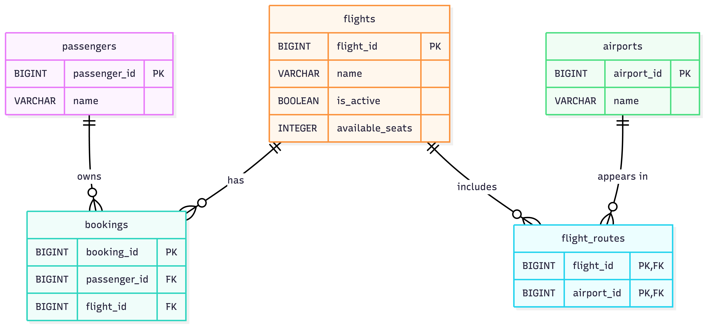

# Airline Booking System

**Name:** Abanoub Samaan

**Theme:** Airline Booking

This system manages airline flights, passengers, bookings, and routes through a relational database.

---
## Domain

The Airline Booking platform is designed to manage information related to flights, passengers, bookings, airports, and the routes connecting flights to airports. The system keeps track of passengers and their bookings, the flights available, and the airports associated with each flight. The goal is to organize this information in a relational database so that it can be stored, updated, and queried efficiently.

The platform should be able to answer questions such as which passengers are booked on a specific flight, which flights are associated with a specific airport, and which airports are part of a specific flight route. It should also allow us to find information about available seats, passengers, bookings, and flights, while maintaining the relationships between these different parts of the system.

---
## ERD



---
## Schema

The schema contains five tables: `passengers` stores passenger information, `flights` stores flight information, `bookings` connects passengers to flights, `airports` stores airport information, and `flight_routes` connects flights to airports.

Each table has its own primary key, and `BIGINT` is used for the identifiers. The `bookings` table uses foreign keys to connect passengers and flights, while `flight_routes` is a junction table with a composite primary key of `flight_id` and `airport_id` to prevent duplicate flight-airport relationships. The foreign keys also use different `ON DELETE` choices based on how the related data should be handled.

---
## Query Catalogue

### Unit 4

For these queries, the producer is a flight (`flight_id`) and the event is a booking. When I say "failure," I mean a cancelled booking (`booking_status = 'cancelled'`), and "region" means the country the booking was made in (`booking_country`).

#### 4.1 Basic summaries

**Q1. What does the booking data look like overall?**
Business question: How many bookings do we have, how much money came in, what is the typical fare (and the lowest and highest), and how many different passengers are behind all of it?

```sql
SELECT COUNT(*)                     AS total_bookings,
       SUM(fare_paid)               AS total_paid,
       AVG(fare_paid)               AS average_paid,
       MIN(fare_paid)               AS minimum_paid,
       MAX(fare_paid)               AS maximum_paid,
       COUNT(DISTINCT passenger_id) AS distinct_passengers
FROM bookings;
```

**Q2. Which flights are the busiest, and what do passengers usually pay on each one?**
Business question: Which flights get the most bookings, and how does the average fare change from flight to flight?

```sql
SELECT flight_id,
       COUNT(*)                 AS total_bookings,
       ROUND(AVG(fare_paid), 2) AS average_fare
FROM bookings
GROUP BY flight_id
ORDER BY total_bookings DESC;
```

**Q3. Which flights have enough bookings for their cancellation rate to be trusted?**
Business question: What is the cancellation rate for flights with at least 10 bookings? I picked 10 because with fewer bookings, a single cancellation moves the rate by more than 10 percentage points.

```sql
SELECT flight_id,
       COUNT(*) AS total_bookings,
       SUM(CASE WHEN booking_status = 'cancelled' THEN 1 ELSE 0 END) AS cancelled_bookings,
       ROUND(100.0 * SUM(CASE WHEN booking_status = 'cancelled' THEN 1 ELSE 0 END) / COUNT(*), 2) AS cancellation_rate
FROM bookings
GROUP BY flight_id
HAVING COUNT(*) >= 10
ORDER BY cancellation_rate DESC;
```

**Q4. How does each country do on each flight?**
Business question: For every country and flight combination, how many bookings were made, how many were cancelled, and what was the average fare? This gives regional leaders a row for their own market.

```sql
SELECT booking_country,
       flight_id,
       COUNT(*)                 AS total_bookings,
       SUM(CASE WHEN booking_status = 'cancelled' THEN 1 ELSE 0 END) AS cancelled_bookings,
       ROUND(100.0 * SUM(CASE WHEN booking_status = 'cancelled' THEN 1 ELSE 0 END) / COUNT(*), 2) AS cancellation_rate,
       ROUND(AVG(fare_paid), 2) AS average_fare
FROM bookings
GROUP BY booking_country, flight_id
ORDER BY booking_country, total_bookings DESC;
```

#### 4.2 Detailed breakdowns

**Part A. Which flights have the most cancellations?**
Business question: How many bookings does each flight have, how many of them were cancelled, and is that a lot for the flight's size?

```sql
SELECT flight_id,
       COUNT(*) AS total_bookings,
       SUM(CASE WHEN booking_status = 'cancelled' THEN 1 ELSE 0 END) AS cancelled_bookings
FROM bookings
GROUP BY flight_id
ORDER BY cancelled_bookings DESC;
```

**Part B. How is each country doing, and how does that compare to the whole platform?**
Business question: Is a country's cancellation problem its own, or part of a platform-wide trend? Rows with a country name are the regional subtotals, and the row where `booking_country` is NULL is the platform grand total.

```sql
SELECT booking_country,
       COUNT(*) AS total_bookings,
       SUM(CASE WHEN booking_status = 'cancelled' THEN 1 ELSE 0 END) AS cancelled_bookings
FROM bookings
GROUP BY ROLLUP (booking_country)
ORDER BY booking_country;
```

**Part C. What is a normal cancellation rate for busy flights?**
Business question: What baseline can we use to tell whether a high-volume flight is doing better or worse than normal?

```sql
WITH flight_summary AS (
    SELECT flight_id,
           COUNT(*) AS total_bookings,
           SUM(CASE WHEN booking_status = 'cancelled' THEN 1 ELSE 0 END) AS cancelled_bookings,
           ROUND(100.0 * SUM(CASE WHEN booking_status = 'cancelled' THEN 1 ELSE 0 END) / COUNT(*), 2) AS cancellation_rate
    FROM bookings
    GROUP BY flight_id
)
SELECT COUNT(*) AS high_volume_flights,
       ROUND(AVG(cancellation_rate), 2) AS baseline_cancellation_rate
FROM flight_summary
WHERE total_bookings >= 10;
```

#### 4.3 Finding

**Overall cancellation rate**
Business question: Out of every booking we have, what share ended up cancelled?

```sql
SELECT COUNT(*) AS total_bookings,
       SUM(CASE WHEN booking_status = 'cancelled' THEN 1 ELSE 0 END) AS cancelled_bookings,
       ROUND(100.0 * SUM(CASE WHEN booking_status = 'cancelled' THEN 1 ELSE 0 END) / COUNT(*), 2) AS overall_rate
FROM bookings;
```